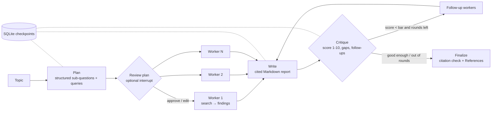

# Deep Research Agent

**Give it a topic. It plans sub-questions, researches them in parallel, writes a report that
cites every claim, has a critic score the draft, researches the gaps and revises, then checks
every citation deterministically. Every step is checkpointed, so a run can pause for your
approval of the plan, survive a crash, and be resumed later.**

<!-- demo GIF: docs/demo.gif (record with the Streamlit UI) -->

## Why this project
One search and one LLM call (the "baseline") gives shallow, single-angle reports. Long agent
loops can be slow, expensive and hard to trust. This project uses well-known agent patterns
(orchestrator-workers, reflexion and human-in-the-loop) with hard limits, and evaluates the
agent **against the baseline** to show whether the extra cost buys better reports.

## Architecture



- **LangGraph** `StateGraph`. Workers fan out with `Send`, their sources and findings merge
  through list reducers, and the critique loop is bounded by `MAX_ROUNDS` and `QUALITY_BAR`.
- **Structured outputs** for the plan, findings, critique and judge, so a weak model fails in one
  step, which falls back, instead of derailing the run.
- **Citations are global and checked.** Sources are numbered once by URL across all workers, the
  writer cites those numbers, and `finalize` removes references to sources that don't exist,
  counts paragraphs without a citation, and rebuilds the References list from what was cited.
- **Human in the loop:** with `APPROVE_PLAN=1` the run pauses at `interrupt()`. Resume with
  approval, an edited list of sub-questions, or a rejection, even from another process.
- **Search providers:** Tavily (API key), Wikipedia and arXiv (no keys), or an offline corpus for
  tests. Results are interleaved and de-duplicated, and a failing provider is skipped.

## Evaluation

`make eval` runs the agent and the baseline on 8 technical topics (`evals/topics.jsonl`), each
with 5 hand-written key points:

| Metric | How |
|---|---|
| Key-point coverage | an LLM judge marks which key points each report covers |
| Valid citations · uncited paragraphs | deterministic, from the citation checker |
| Pairwise preference | the judge compares both reports **twice with the order swapped**; a win needs both orders to agree, which controls for position bias |
| Cost | seconds per report, critique rounds, sources cited |

Results (run `make eval` with your model; `evals/results.md` is written for you):

| Metric | Agent | Baseline |
|---|---|---|
| Key-point coverage | _run `make eval`_ | |
| Valid citations | | |
| Uncited paragraphs | | |
| Sources cited | | |
| Seconds per report | | |
| Pairwise wins (agent / baseline / tie) | | |

Use a judge model that is stronger than, and different from, the model under test
(`JUDGE_PROVIDER=openai JUDGE_MODEL=gpt-4o`).

## Quick start

```bash
python -m venv .venv && source .venv/bin/activate
make install                                  # pip install -e ".[dev,ui]"
ollama pull qwen3:8b                          # or LLM_PROVIDER=openai / anthropic

research run "How does speculative decoding speed up LLM inference?" --out report.md
research run "Mixture-of-experts trade-offs" --approve-plan    # pauses after planning
research resume <thread>                                        # approve and continue
research resume <thread> --sub-question "..." --sub-question "..."   # or replace the plan
research show <thread>
make api            # POST /research, GET /research/{id}, POST /research/{id}/approve
make ui             # Streamlit (needs the API running)
make test           # offline: scripted model + offline search corpus
```

Docker: `docker compose up --build`, then `docker compose exec ollama ollama pull qwen3:8b`.

## Design decisions and trade-offs

| Decision | Why | Trade-off |
|---|---|---|
| Planner + parallel workers (orchestrator-workers) | breadth: each sub-question gets its own searches, and the workers run concurrently | more LLM calls (one extraction per worker) |
| Workers extract findings before writing | the writer sees compact, attributed facts instead of raw pages, which keeps the context small and citations precise | extraction can drop nuance |
| Critic + bounded revision loop (reflexion) | targeted follow-up searches for what is missing | each round costs a write + a critique; the critic can be lenient, so the bar is configurable |
| Deterministic citation check after the LLM | catches invented `[n]` numbers and uncited paragraphs without another model call | checks that a source *exists*, not that it *supports* the claim (the critic and the judge cover that) |
| SQLite checkpointer | pause/resume, crash recovery and inspection of every step for free | one file; use Postgres for many concurrent users |
| Strip `<think>` blocks | reasoning models (e.g. qwen3) otherwise leak their thoughts into the report | none |
| Baseline in the eval | an agent is only worth its latency if it beats a cheap baseline | the judge is an LLM: use a different, stronger one, and read some reports yourself |

## Project layout

```
src/deep_research/
  config.py     settings (provider, search, rounds, quality bar, plan approval, checkpoint db)
  llm.py        chat-model factory (ollama | openai | anthropic | fake) + scripted fake model
  search.py     tavily | wikipedia | arxiv | fake, multi-provider merge
  graph.py      the LangGraph workflow + Researcher (start / resume / status)
  citations.py  deterministic citation check and References
  baseline.py   one search + one call, for comparison
  api.py ui.py cli.py
evals/          topics.jsonl + run_eval.py (agent vs baseline, LLM judge)
tests/          every graph path (loop, cap, approve/edit/reject, resume in a new process), citations, search, API, eval
```
